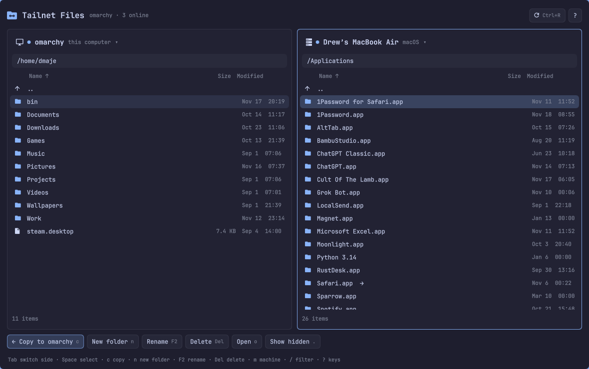

# Tailnet Files

An Omarchy shell plugin for browsing the machines on your tailnet and copying
files and folders between them. It has two panes, one per side. Each side can
be this computer or any machine on your tailnet. Folders are listed over SFTP
and copied over SSH inside your tailnet.

Plugin id: `dmaje.tailfiles`



## Install

```bash
omarchy plugin add https://github.com/dmajerus6/omarchy-tailnet-files.git --enable
```

Then click the folder icon in the bar.

### Requirements

- Tailscale, signed in (`tailscale status` must work)
- OpenSSH client: `ssh`, `sftp`, `scp`, `ssh-keygen`, `ssh-copy-id` (Omarchy ships these)
- Python 3, standard library only
- `xdg-open` (xdg-utils) to open files in their default app
- `gio` (glib2) to move local deletes to the Trash
- On Linux and macOS machines you copy to or from, rename on or Replace
  into: `perl` 5.22 or newer (included with macOS, Debian, Ubuntu and
  Raspberry Pi OS)
- Optional: `notify-send` for "transfer finished" notifications

The plugin runs as your user, needs no root access, and does not edit your
Hyprland config, keybindings or `~/.ssh/config`. It writes only:

- `~/.config/tailfiles/hosts.json`: the user name per machine and the last machine you opened
- `~/.cache/tailfiles/open/`: remote files downloaded to open them locally
- `$XDG_RUNTIME_DIR/tailfiles/`: SSH connection sockets and short-lived caches

Things it changes only when you ask it to:

- **Set up SSH key** creates `~/.ssh/id_ed25519` if you have no key, and adds
  your public key to the other machine.
- The first connection to a machine adds its host key to `~/.ssh/known_hosts`.

### Remove

```bash
omarchy plugin remove dmaje.tailfiles
rm -rf ~/.config/tailfiles ~/.cache/tailfiles   # optional: saved settings and downloads
```

## Using it

Click the folder icon in the bar. You can also bind a key to it in
`~/.config/hypr/bindings.lua`:

```lua
o.bind("SUPER + SHIFT + F", "Tailnet Files", "omarchy-shell shell toggle dmaje.tailfiles '{}'")
```

To open the window with a particular machine on the right side:

```bash
omarchy-shell shell summon dmaje.tailfiles '{"host":"my-laptop"}'
```

Click the machine name at the top of a pane (or press `m`) to switch machines.
Select items with Space, Ctrl+click or Shift+click, then press `c` to copy
them into the folder shown on the other side. Transfers are queued and show
live progress. They keep running when you close the window, and you get a
notification when each one finishes.

| Key | Action |
| --- | --- |
| Tab | Switch side |
| j / k, arrows, PgUp / PgDn, g / G | Move |
| Enter, l, → | Open a folder, or a file in its default app |
| Backspace, h, ← | Parent folder |
| Space, Insert / Ctrl+A | Select / select all |
| c, F5 | Copy selection to the other side |
| n, F7 | New folder |
| F2, R | Rename |
| Del, F8, D | Delete (asks first) |
| o | Open with the default app (remote files download to `~/.cache/tailfiles/open/` first) |
| m | Choose a machine |
| / | Filter the listing |
| Ctrl+L | Type a path (`~` means that machine's home) |
| . or Ctrl+H | Show hidden files |
| s | Change sort order (name, modified, size) |
| ~ | Home folder |
| = | Open this folder on the other side too |
| r, Ctrl+R | Refresh (Ctrl+R also reloads the machine list) |
| Esc | Clear the selection or filter, otherwise close |
| ? | Show the keys |

## Setting up a machine

Each machine needs an SSH server you can sign in to without a password prompt:

- **Linux / Raspberry Pi:** `sshd` running.
- **macOS:** System Settings › General › Sharing › Remote Login.
- **Windows:** the built-in "OpenSSH Server" optional feature. Windows
  machines are reached over SFTP and can be browsed, opened from, and have
  folders made and items deleted. Copying to or from them, and renaming on
  them, isn't available (see below).

Then use one of these to sign in:

1. **SSH key (default).** If a machine refuses you, its pane shows *Set up SSH
   key*. That opens a terminal that asks for that machine's password once.
   It creates `~/.ssh/id_ed25519` first if you have no key yet. On Linux and
   macOS it runs `ssh-copy-id`. On Windows (as reported by Tailscale) it adds
   the key with PowerShell instead. It writes to your
   `.ssh\authorized_keys`, and for administrator accounts also to
   `C:\ProgramData\ssh\administrators_authorized_keys`, with the
   permissions Windows OpenSSH requires. Either way, it then tries a key
   sign-in and tells you whether it worked.
2. **Tailscale SSH.** On a Linux or macOS machine, run
   `tailscale set --ssh` as root and Tailscale handles sign-in. You don't need
   keys.

If your user name differs on a machine, use *Change user* in its pane. The
setting is saved in `~/.config/tailfiles/hosts.json`. Settings in
`~/.ssh/config` (User, IdentityFile, Port and so on) are also respected.

## How it works

- `bin/tailfiles` is a Python helper (standard library only) that the QML
  calls. Each command prints JSON. You can run it yourself:
  `bin/tailfiles peers`, `bin/tailfiles ls raspberrypi /home/pi`, and so on.
- Machines come from `tailscale status --json`. Phones and tablets are left
  out.
- SSH connections are shared through a ControlMaster socket in
  `$XDG_RUNTIME_DIR/tailfiles/`, so you only wait for the first connection to a
  machine. Every later listing reuses it.
- New host keys are accepted the first time (`StrictHostKeyChecking=accept-new`).
  After that, a changed key is refused. Tailscale already confirms which
  machine you're talking to.
- Copies hold folders open instead of trusting paths. On this computer the
  helper uses directory file descriptors; on Linux and macOS machines it
  sends a small fixed Perl program over stdin (paths travel as data, never
  through a shell). Copies between two machines stream from one to the
  other through this computer without touching its disk.
- Reading: each folder is held open while it is read and every file is
  opened with `O_NOFOLLOW` and checked to be the object that was examined
  (same device and inode). Something swapped in by name during a copy is
  never read; the copy stops instead. Symlinks are copied as symlinks,
  never followed, whether selected or inside a folder. Sockets, devices and
  pipes are skipped, and the finished copy says how many.
- Writing: a copy goes into a new hidden folder (`.tailfiles-incoming-…`)
  inside the destination, created exclusively, checked to be the private,
  empty folder this copy just made, and then held open until it is removed.
  It is never looked up by name again, so a folder someone else renames in
  under that name in a shared destination is never written to or moved
  from. Every file is created `O_CREAT|O_EXCL|O_NOFOLLOW`. Each item is then moved
  into place with a rename that refuses to replace anything, relative to
  the folders it holds open: `renameat2(RENAME_NOREPLACE)` on Linux,
  `renameatx_np(RENAME_EXCL)` on macOS. If the disk can't refuse
  atomically, the item isn't moved and the copy fails. A name that appears
  during the copy, or that differs only in case on a case-insensitive disk,
  is never overwritten. The hidden folder is emptied through the handle and
  removed when the copy ends (including when it fails or is cancelled), and
  its name only while it still is that folder.
- Nothing another machine sends can make the helper use unbounded memory:
  names, link targets and numbers in a copy are capped, folder nesting is
  capped at 512, replies to other commands at 64 MB, and only the end of
  any error output is kept.
- With Replace, files and symlinks replace files and symlinks with one
  atomic rename (a symlink is replaced itself, never written through), and
  folders merge only into real folders, each held open (and checked to be
  the one examined) while its contents move in. A file never replaces a
  folder or the other way round.
- Rename uses the same atomic no-replace rename, here and on Linux and
  macOS machines.
- Windows: SFTP can't hold a folder open or rename without a chance of
  replacing something, and Windows has no shell to do it for us, so copying
  to or from a Windows machine and renaming on it are refused.
- The account is fixed per machine for a whole run, so both sides of a copy
  between two panes on one machine must use the same account; the window
  and the helper refuse otherwise.
- Remote folder listings come from sftp's text output, read exactly: no
  trimming, and lines split only at `\n`. On Linux and macOS every listed
  name is also checked against the folder's exact names (a fixed
  `find -print0`). A name sftp can't print faithfully, such as one with a
  line break or a non-printable character, is left out rather than guessed.
- Paths are always handled literally, even names with `*`, `?`, `[`, quotes
  or spaces. SFTP commands escape every special character the way sftp(1)
  documents, so sftp never globs a name, and the copy helpers get paths as
  data. Names containing control characters are refused.
- Deleting on this computer only ever moves things to the Trash (`gio trash`).
  If that fails, the item stays where it is; there is no permanent fallback.
  Deleting on another machine is permanent. The helper refuses to delete `/`,
  a drive root, that machine's home folder or anything containing it, or any
  path with `.` or `..` in it. It looks up the home folder fresh before each
  delete (on Windows, from where SFTP starts) and deletes nothing if it can't.
  It checks each path both as written and with its parent folders' symlinks
  resolved by the machine that holds it. On Linux and macOS the paths then go
  NUL-separated over stdin to one fixed remote script, which enters each
  parent folder physically, checks the real location against the account's
  home again, and removes the item relative to that folder, so nothing can
  redirect it between the check and the delete. On Windows it walks the
  folder over SFTP and builds every command before running any. A selected
  symlink is removed itself, never its target.
- Every reply from `sftp` must have the exact shape of the commands sent
  (each command echoed, `cd` silent, `pwd` one line). A folder or file name
  containing a line break breaks that shape, so the action stops instead of
  reading a shorter path.
- Each run of the helper fixes the SSH account once and passes it to every
  `ssh`/`sftp`/`scp` it starts. The window sends the account each
  listing was made under, so a dialog or copy acts as that account even if
  *Change user* saves another one meanwhile.
- Nothing is overwritten without asking. Copying onto a name that already
  exists asks to replace it first. If the helper finds a clash the listing
  didn't show, the copy stops and its row offers Replace. Rename never
  replaces an existing item.
- Files downloaded to open them lose their execute bits.
- A New folder, Rename, Delete or Replace dialog acts only on the machine,
  account and folder it was opened for. If that side changes before you
  confirm, nothing happens.

## Files

```
manifest.json     plugin manifest (bar widget + panel, keepLoaded)
BarWidget.qml     bar icon, toggles the window
App.qml           window, transfer queue, dialogs, keyboard
FilePane.qml      one side: machine picker, path, listing
Backend.qml       runs the helper
ActionButton.qml, PlainText.qml
i18n/en.json      strings
bin/tailfiles     helper
```

## Developing

Work from a checkout by linking it in place of the installed copy:

```bash
ln -s "$PWD" ~/.config/omarchy/plugins/dmaje.tailfiles
omarchy-shell shell rescanPlugins
omarchy plugin enable dmaje.tailfiles
```

Changes to `bin/tailfiles` apply on the next action. QML changes need
`omarchy restart shell`.

## Floating window

To make the window open floating and centered, add this to
`~/.config/hypr/hyprland.lua`:

```lua
o.window({ class = "^org\\.quickshell$", title = "^Tailnet Files$" }, { float = true, center = true, size = { 1180, 740 } })
```

## License

MIT. See [LICENSE](LICENSE).

Third-party Omarchy plugins run unsandboxed in the shell process. Read the
source before you enable it.
